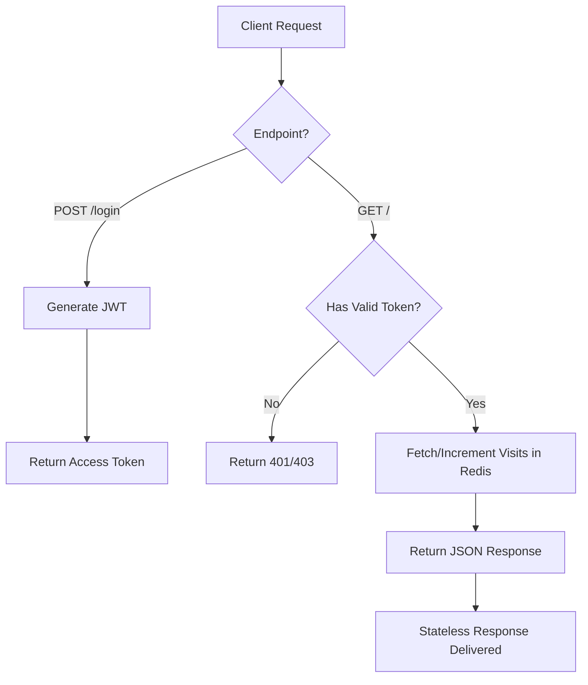
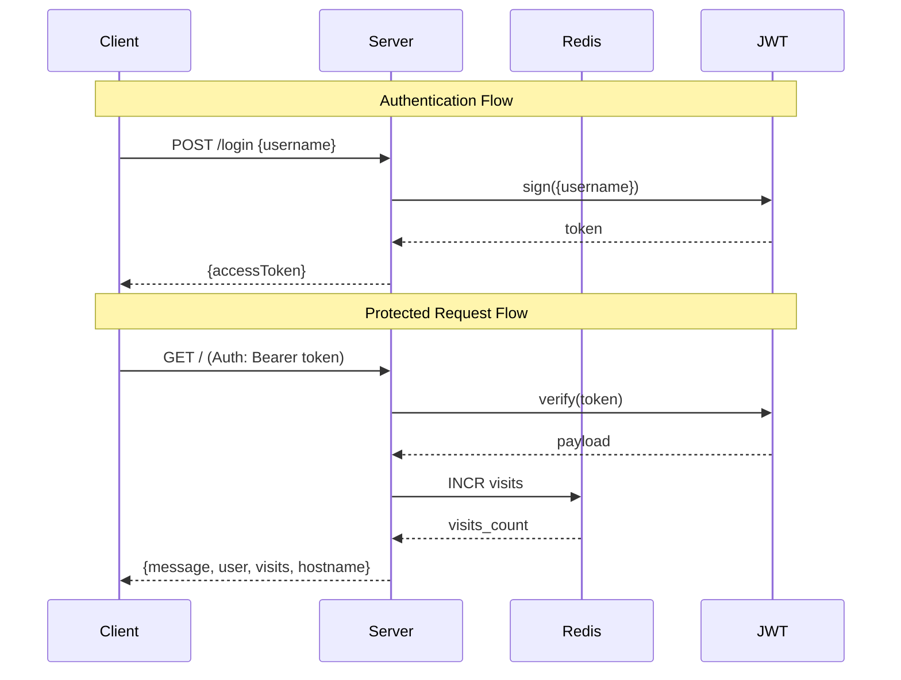

# Node.js Stateless Server with Redis and Authentication

This repository demonstrates a stateless Node.js server using Redis for state management and JWT for authentication. By keeping the server stateless, we can easily scale the application horizontally.

## How it Works

### Request Flow



### Sequence Diagram



## Architecture

- **Node.js (Express)**: The application server.
- **Redis**: An in-memory data store used to persist state (visits count) outside of the application instance.
- **JWT (JSON Web Token)**: Used for stateless authentication.
- **Docker Compose**: Orchestrates the application and Redis services.
- **pnpm**: Fast, disk space efficient package manager.

## Prerequisites

- Docker
- Docker Compose
- [pnpm](https://pnpm.io/) (for local development)

## Getting Started

1. Clone the repository.
2. Install dependencies:
   ```bash
   pnpm install
   ```
3. Run the application using Docker Compose:

   ```bash
   docker-compose up --build
   ```

4. The server will be available at `http://localhost:3000`.

## API Endpoints

### 1. Login
- **URL**: `/login`
- **Method**: `POST`
- **Body**: `{ "username": "your_name" }`
- **Response**: `{ "accessToken": "..." }`

### 2. Protected Route
- **URL**: `/`
- **Method**: `GET`
- **Headers**: `Authorization: Bearer <your_token>`
- **Response**: `{ "message": "...", "user": "...", "visits": 1, "hostname": "..." }`

## Features

- **Statelessness**: No state is stored in the application's memory.
- **Redis Integration**: Uses Redis to store and increment a visitor counter.
- **JWT Authentication**: Secure, stateless user authentication.
- **TypeScript**: Written in TypeScript for better developer experience and type safety.
- **Dockerized**: Fully containerized for easy deployment and development.
